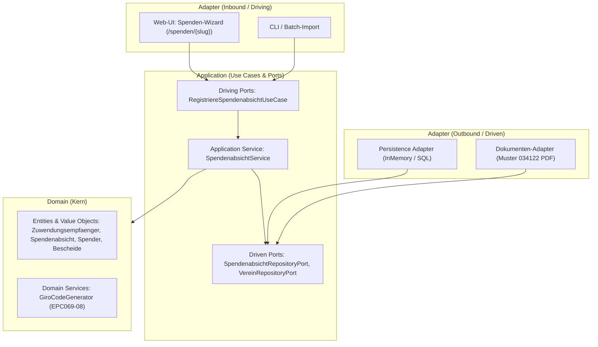

# Technische Architektur und Domänenmodellierung

Dieses Dokument beschreibt die technische Architektur, die eingesetzten Technologien sowie die Umsetzung der fachlichen Vorgaben und Invarianten im Code.

---

## 1. Technologie-Stack

| Komponente | Technologie | Version | Rationale |
|---|---|---|---|
| **Programmiersprache** | Kotlin | 2.1.x | Ausgezeichnete Unterstützung für DDD (Data Classes, Immutability, Sealed Classes, Type-Safety). |
| **Laufzeitumgebung** | Java Virtual Machine (JVM) | 21 (LTS) | Moderner Standard für JVM-basierte Enterprise- und Fachanwendungen. |
| **Build-Tool** | Gradle (Kotlin DSL) | 9.2.x | Schnelle, typsichere Build-Konfiguration (`build.gradle.kts`) mit Wrapper (`./gradlew`). |
| **Test-Framework** | JUnit Jupiter (JUnit 5) | 5.11.x | Standard für Modultests; unterstützt `@Nested`-Strukturen und sprechende Testnamen. |
| **Assertion-Bibliothek** | Kotlin Test / AssertJ | 3.27.x | Klare, lesbare Fehlerbeschreibungen bei fehlschlagenden Invariantenprüfungen. |

---

## 2. Hexagonale Architektur (Ports & Adapters) und Domain-Driven Design (DDD)

Das System folgt streng den Prinzipien der **Hexagonalen Architektur**. Abhängigkeiten zeigen grundsätzlich von außen nach innen zum fachlichen Domänenkern:



### Paketstruktur
```text
src/
├── main/
│   └── kotlin/
│       └── de/ad26/team07/
│           ├── domain/                               // KERN: Fachlogik & Invarianten
│           │   ├── model/
│           │   │   ├── Gemeinnuetzigkeitsbescheid.kt // Freistellungs- & Feststellungsbescheid
│           │   │   ├── Adresse.kt                    // Value Object
│           │   │   ├── SteuerbeguenstigterZweck.kt   // Value Object (§ 52 AO)
│           │   │   ├── Spender.kt                    // Entity/VO (Name, Anschrift, E-Mail)
│           │   │   ├── WhiteLabelKonfiguration.kt    // Slug, Branding, Farben
│           │   │   ├── Zuwendungsempfaenger.kt       // Verein mit Bankverbindung (IBAN/BIC)
│           │   │   ├── Gegenleistungsverzichtserklaerung.kt // Verzicht & Gegenleistungsfreiheit
│           │   │   ├── SpendenabsichtStatus.kt       // ANGEKUENDIGT, EINGEGANGEN, ABGELAUFEN
│           │   │   └── Spendenabsicht.kt             // Pledge mit Referenzcode & GiroCode
│           │   └── service/
│           │       └── GiroCodeGenerator.kt          // SEPA EPC069-08 Generator
│           ├── application/                          // USE CASES & PORTS
│           │   ├── port/
│           │   │   ├── in/                           // Driving Ports
│           │   │   │   ├── RegistriereSpendenabsichtUseCase.kt
│           │   │   │   └── RegistriereSpendenabsichtCommand.kt
│           │   │   └── out/                          // Driven Ports
│           │   │       ├── SpendenabsichtRepositoryPort.kt
│           │   │       └── VereinRepositoryPort.kt
│           │   └── service/
│           │       └── SpendenabsichtService.kt      // Orchestrierung der Spendenabsicht
│           └── adapter/                              // INFRASTRUKTUR & AUSSENWELT
│               ├── in/                               // Web / REST / CLI
│               └── out/                              // Persistence / PDF / Mail
└── test/
    └── kotlin/
        └── de/ad26/team07/
            ├── domain/
            │   ├── model/
            │   │   ├── GemeinnuetzigkeitsbescheidTest.kt
            │   │   └── SpendenabsichtTest.kt
            │   └── service/
            │       └── GiroCodeGeneratorTest.kt
            └── application/
                └── service/
                    └── SpendenabsichtServiceTest.kt
```

### Abbildung von Fachregeln im Code

#### Bescheidwesen (`Gemeinnuetzigkeitsbescheid`)
Das Bescheidwesen ist als `sealed class` modelliert, um den steuerrechtlichen Rahmen vollständig und typsicher abzubilden:

1. **`Freistellungsbescheid` (§ 63 Abs. 5 AO):**
   * *Fachliche Regel:* Körperschaftsteuerbefreiung nach Veranlagung; Gültigkeit höchstens 5 Jahre ab Bescheiddatum.
   * *Umsetzung:* Methode `istGueltigAm(datum: LocalDate): Boolean` prüft, ob das Prüfdatum zwischen Bescheiddatum und Bescheiddatum + 5 Jahre liegt.
2. **`Feststellungsbescheid` (§ 60a AO):**
   * *Fachliche Regel:* Vorläufiger Nachweis der satzungsmäßigen Voraussetzungen (z. B. bei Neugründungen); Gültigkeit höchstens 3 Jahre.
   * *Umsetzung:* Methode `istGueltigAm(datum: LocalDate): Boolean` prüft, ob das Prüfdatum zwischen Feststellungsdatum und Feststellungsdatum + 3 Jahre liegt.

#### Spendenabsicht (`Spendenabsicht`) & EPC-GiroCode
Die Spendenabsicht modelliert das Spendeversprechen (Pledge) im Statuszyklus:
1. **Statusübergänge:** `ANGEKUENDIGT` -> `EINGEGANGEN` (durch Bankauszugsabgleich) oder `ABGELAUFEN`.
2. **Gegenleistungsverzicht:** Invariante OCL 7 erzwingt, dass eine Zuwendung nur als Spende registriert werden darf, wenn der Spender ausdrücklich auf Gegenleistungen verzichtet hat.
3. **SEPA EPC069-08 Payload:** Der Domain Service `GiroCodeGenerator` baut normgerechte UTF-8-Nutzdaten für SEPA Credit Transfers auf:
   * Service Tag: `BCD`, Version: `002`, Character Set: `1` (UTF-8), Ident: `SCT`.
   * BIC, Empfängername (max. 70 Zeichen), bereinigte IBAN, Betrag in EUR (auf 2 Nachkommastellen kaufmännisch gerundet), Verwendungszweck (`SP-YYYY-NNNN`).

#### Client-Side Prototyp & VanillaQR
Für die interaktive Spenden-Demo ([`demo/spenden_wizard.html`](../demo/spenden_wizard.html)) existiert eine autarke QR-Engine ([`demo/vanilla_qr.js`](../demo/vanilla_qr.js)):
* Arbeitet ohne externe CDNs oder Abhängigkeiten, vollständig offline und über das lokale `file:///`-Protokoll.
* Generiert Vektor-SVGs mit Reed-Solomon-Fehlerkorrektur (Level M) und nativer UTF-8-Unterstützung (Umlaute wie in Vereinsnamen oder Straßennamen).

---

## 3. Testkonzept und Test-Driven Development (TDD)

Die steuerrechtlichen Compliance-Regeln erfordern höchste Präzision, da fehlerhafte Zuwendungsbestätigungen zur Falschausstellerhaftung (§ 54 Abs. 2 EStG) führen können.

* **Isolierte Modultests:** Jede fachliche Invariante wird durch Unit-Tests ohne externe Abhängigkeiten oder Mocks geprüft.
* **Grenzprüfungen (Boundary Value Analysis):**
  * Gültigkeit am Tag des Bescheid-Erlasses (untere Grenze).
  * Gültigkeit exakt am Stichtag des Fristendes (obere Grenze).
  * Ungültigkeit am Tag nach Ablauf der Frist.
  * Ungültigkeit für Datumsangaben vor der Bescheidausstellung.
* **Sprechende Testspezifikation:** Durch Kotlin-Backtick-Namen (`fun \`ist exakt 5 Jahre nach Ausstellung noch gueltig\`()`) dokumentieren die Tests direkt die fachlichen Anforderungen.

### Testübersicht (Stand: 19 Tests, 100% Erfolgsquote)

| Testklasse | Testanzahl | Fachbereich / Abgedeckte Regeln |
|---|---|---|
| [`GemeinnuetzigkeitsbescheidTest`](../src/test/kotlin/de/ad26/team07/domain/model/GemeinnuetzigkeitsbescheidTest.kt) | 7 | Fristen nach § 63 Abs. 5 AO (5 Jahre) und § 60a AO (3 Jahre), Vor- und Nachlaufdaten |
| [`SpendenabsichtTest`](../src/test/kotlin/de/ad26/team07/domain/model/SpendenabsichtTest.kt) | 4 | Betragsvalidierung (> 0 €), Statusübergang `ANGEKUENDIGT` -> `EINGEGANGEN`, Verhinderung doppelter Statusübergänge |
| [`GiroCodeGeneratorTest`](../src/test/kotlin/de/ad26/team07/domain/service/GiroCodeGeneratorTest.kt) | 4 | EPC069-08 Normkonformität, kaufmännische Rundung, Pflichtfeldvalidierung |
| [`SpendenabsichtServiceTest`](../src/test/kotlin/de/ad26/team07/application/service/SpendenabsichtServiceTest.kt) | 4 | Inbound-Use-Case Orchestrierung, OCL-Invariante 7 (Gegenleistungsverzicht), Satzungszweck-Validierung, Mandanten-Prüfung |

