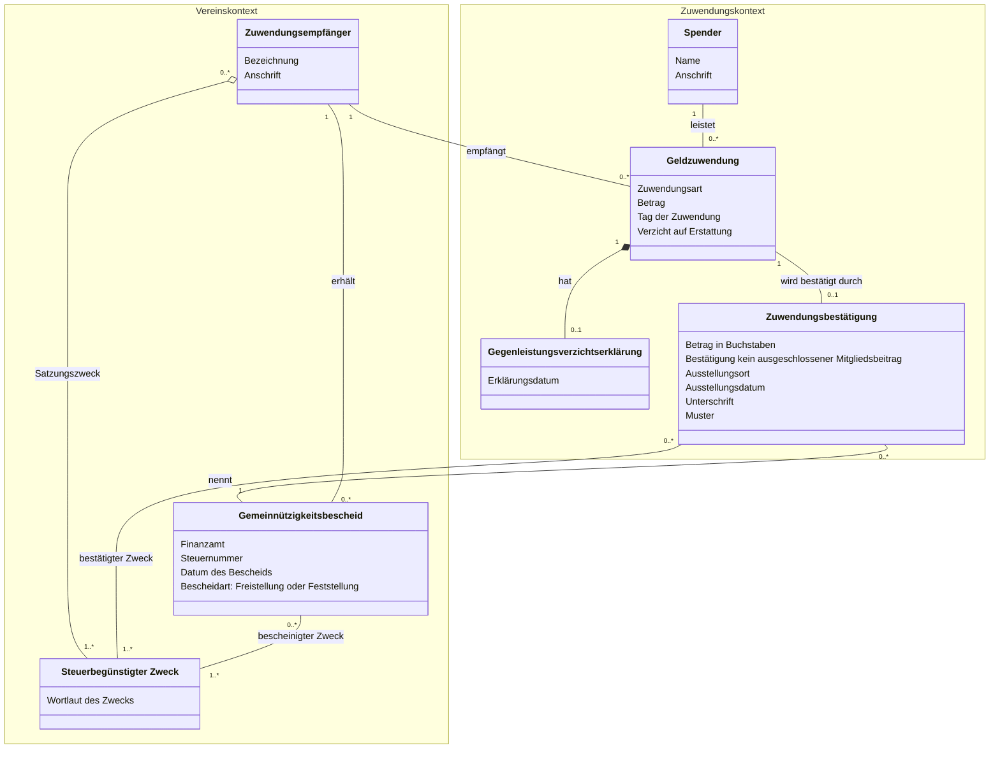
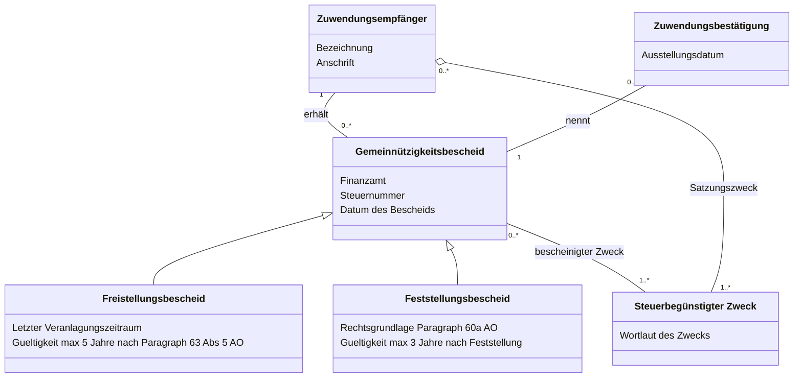

# Datenmodell: Zuwendungsbestätigung für Geldzuwendungen (Muster 034122)

Dieses Datenmodell bildet die fachlichen Geschäftsobjekte und Beziehungen für die Ausstellung von Zuwendungsbestätigungen (Spendenquittungen) nach amtlichem BMF-Muster 034122 (Fassung 2013) auf Vereinsebene ab.

Das Modell ist hierarchisch in zwei Detaillierungsstufen unterteilt:
* **Level 1 (Gesamtübersicht):** Primäre Geschäftsobjekte der Spendenabwicklung.
* **Level 2 (Detailmodell Gemeinnützigkeitsbescheid):** Drill-Down in die steuerrechtliche Vererbungshierarchie der Bescheide und deren Gültigkeitsfristen.

---

## Level 1: Gesamtübersicht

Konzentriert sich auf den Kernprozess: Der Spender leistet eine Geldzuwendung, der Verein als Zuwendungsempfänger empfängt sie, prüft den Gemeinnützigkeitsbescheid und stellt die Zuwendungsbestätigung aus.

---

## Level 2: Detailmodell Gemeinnützigkeitsbescheid & Fristen

Detailansicht der Spezialisierungen des Gemeinnützigkeitsbescheids nach Abgabenordnung (AO):

* **Freistellungsbescheid (Regelfall):** Körperschaftsteuerbefreiung nach Veranlagung. Gültigkeitsdauer: höchstens 5 Jahre ab Bescheiddatum (§ 63 Abs. 5 AO). Pflichtangabe: *Letzter Veranlagungszeitraum*.
* **Feststellungsbescheid (§ 60a AO):** Vorläufige Feststellung der satzungsmäßigen Voraussetzungen (z. B. Neugründungen oder nach Satzungsänderungen). Gültigkeitsdauer: höchstens 3 Jahre.
* **Entweder-Oder (Regel 3):** Auf der Zuwendungsbestätigung wird genau einer der beiden Bescheide angegeben.

