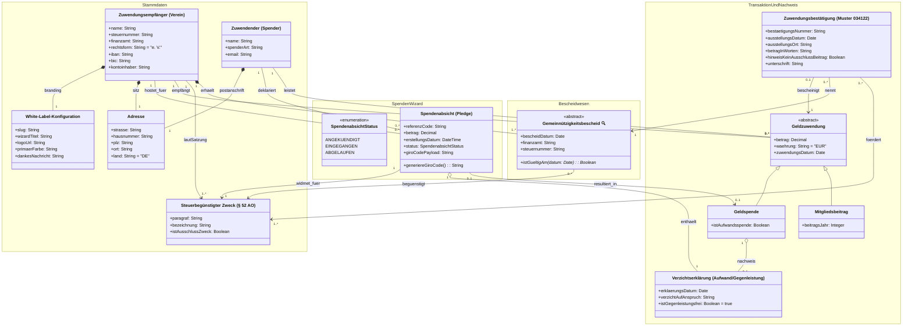
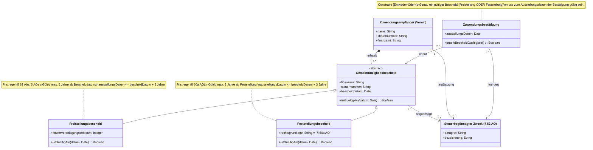

# Datenmodell: Zuwendungsbestätigung für Geldzuwendungen (Muster 034122)

Dieses Datenmodell bildet die fachlichen Geschäftsobjekte, Value Objects, Beziehungen und steuerrechtlichen Invarianten für die Ausstellung von Zuwendungsbestätigungen (Spendenquittungen) nach amtlichem BMF-Muster 034122 (Fassung 2013) auf Vereinsebene ab.

Das Modell ist streng nach den Prinzipien des **Domain-Driven Designs (DDD)** und formaler **UML-Spezifikation** atomar aufgebaut:
* **Atomare Value Objects:** Kapselung von Adress- und Betragsdaten (1. Normalform).
* **Polymorphe Spezialisierung:** Aufspaltung von `Geldzuwendung` in `Geldspende` (inkl. `Aufwandsspende`) und `Mitgliedsbeitrag`.
* **Trennung von Daten und Regeln:** Fristen (§ 63 Abs. 5 AO, § 60a AO) sind als Methoden und Invarianten ({Constraints}) formuliert, nicht als Pseudodatenfelder.
* **Hierarchische Detaillierungsstufen:**
  * **Level 1 (Atomare Gesamtübersicht):** Primäre Geschäftsobjekte, Value Objects und Transaktionen.
  * **Level 2 (Detailmodell Gemeinnützigkeitsbescheid):** Steuerrechtliche Vererbungshierarchie der Bescheide, Fristen und Gültigkeitsprüfungen.

---

## Level 1: Atomare Gesamtübersicht

Konzentriert sich auf den Gesamtprozess von der Vorankündigung im White-Label-Spenden-Wizard bis zur Bestätigung: Der Spender durchläuft den vereinsgebrandeten Wizard (Spendenabsicht mit EPC-GiroCode und Verzichtserklärung), tätigt die Geldspende, und das System prüft Satzungszwecke sowie Bescheide für die Zuwendungsbestätigung.



---

## Level 2: Detailmodell Gemeinnützigkeitsbescheid & Fristen

Detailansicht der Spezialisierungen des Gemeinnützigkeitsbescheids nach Abgabenordnung (AO) und deren Validierungslogik:

* **Freistellungsbescheid (Regelfall):** Körperschaftsteuerbefreiung nach Veranlagung. Gültigkeitsdauer: höchstens 5 Jahre ab Bescheiddatum (§ 63 Abs. 5 AO). Pflichtangabe: *Letzter Veranlagungszeitraum*.
* **Feststellungsbescheid (§ 60a AO):** Vorläufige Feststellung der satzungsmäßigen Voraussetzungen (z. B. Neugründungen oder nach Satzungsänderungen). Gültigkeitsdauer: höchstens 3 Jahre.
* **Entweder-Oder (Regel 3):** Auf der Zuwendungsbestätigung wird genau einer der beiden Bescheide angegeben, welcher am `ausstellungsDatum` der Bestätigung noch gültig ist.



---

## 3. Fachliche Invarianten & OCL-Constraints

Die nachfolgenden formalen Integritätsbedingungen sichern die steuerrechtliche Compliance:

1. **Gültigkeit des Freistellungsbescheids (§ 63 Abs. 5 AO):**
   ```ocl
   context Freistellungsbescheid::istGueltigAm(datum: Date): Boolean
   body: datum <= self.bescheidDatum.addYears(5)
   ```

2. **Gültigkeit des Feststellungsbescheids (§ 60a AO):**
   ```ocl
   context Feststellungsbescheid::istGueltigAm(datum: Date): Boolean
   body: datum <= self.bescheidDatum.addYears(3)
   ```

3. **Gültiger Bescheid bei Ausstellung:**
   ```ocl
   context Zuwendungsbestaetigung
   inv BescheidIstGueltig:
     self.gemeinnuetzigkeitsbescheid.istGueltigAm(self.ausstellungsDatum) = true
   ```

4. **Zweckkongruenz (Matching):**
   Der auf der Zuwendungsbestätigung genannte Zweck muss sowohl durch den Gemeinnützigkeitsbescheid befreit sein als auch der Satzung des Zuwendungsempfängers entsprechen:
   ```ocl
   context Zuwendungsbestaetigung
   inv ZweckUebereinstimmung:
     self.steuerbeguenstigterZweck->forAll(z |
       self.gemeinnuetzigkeitsbescheid.steuerbeguenstigterZweck->includes(z) and
       self.geldzuwendung.zuwendungsempfaenger.steuerbeguenstigterZweck->includes(z)
     )
   ```

5. **Aufwandsspende und Verzichtserklärung:**
   Wird eine Geldspende als Aufwandsspende deklariert (`istAufwandsspende = true`), muss zwingend eine Gegenleistungsverzichtserklärung vorliegen:
   ```ocl
   context Geldspende
   inv AufwandsspendeErfordertVerzicht:
     self.istAufwandsspende implies self.gegenleistungsverzichtserklaerung->notEmpty()
   ```

6. **Betragskonsistenz:**
   Der numerische Betrag der Geldzuwendung muss mit dem ausgeschriebenen Betrag auf der Bestätigung korrespondieren:
   ```ocl
   context Zuwendungsbestaetigung
   inv BetragStimmig:
     self.betragInWorten = formatInWords(self.geldzuwendung.betrag)
   ```

7. **Gegenleistungsfreiheit im Spenden-Wizard:**
   Jede im Wizard erfasste Spendenabsicht muss eine bestätigte Gegenleistungsverzichtserklärung enthalten:
   ```ocl
   context Spendenabsicht
   inv VerzichtErklaert:
     self.gegenleistungsverzichtserklaerung->notEmpty() and
     self.gegenleistungsverzichtserklaerung.istGegenleistungsfrei = true
   ```

8. **Konsistenz bei Realisierung der Spende:**
   Wird eine Geldspende auf Basis einer Spendenabsicht verbucht, müssen Betrag und Zuwendungsempfänger exakt übereinstimmen:
   ```ocl
   context Geldspende
   inv AbsichtUebereinstimmung:
     self.spendenabsicht->notEmpty() implies
       (self.betrag = self.spendenabsicht.betrag and
        self.zuwendungsempfaenger = self.spendenabsicht.zuwendungsempfaenger and
        self.spendenabsicht.status = SpendenabsichtStatus::EINGEGANGEN)
   ```
